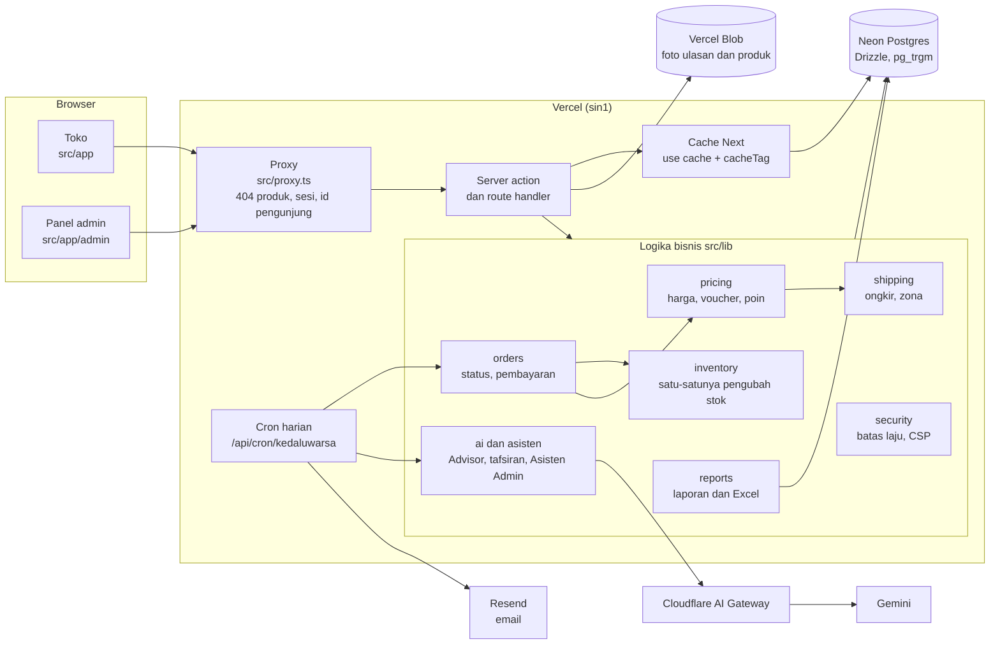
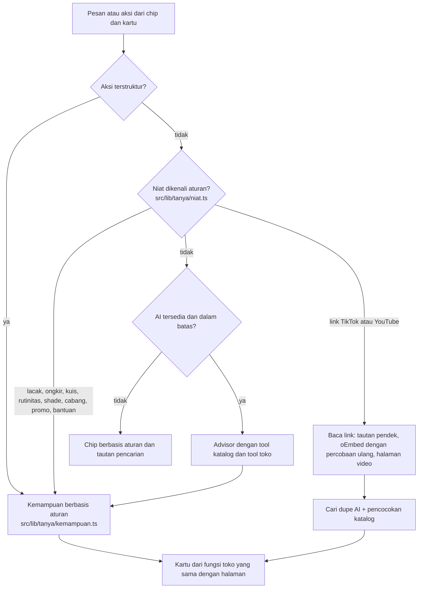
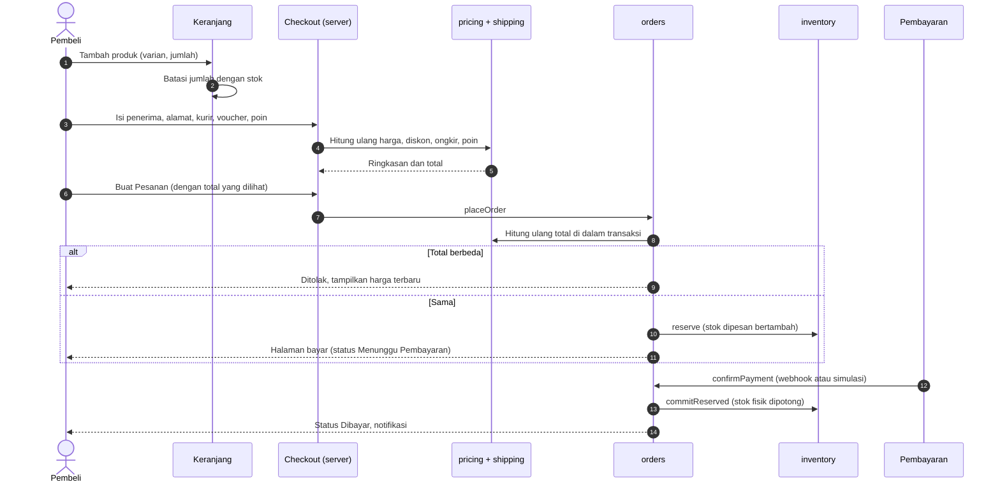
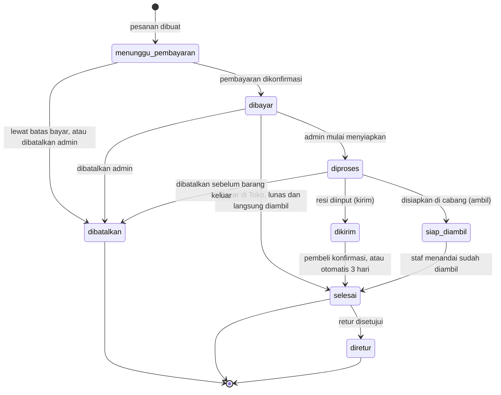
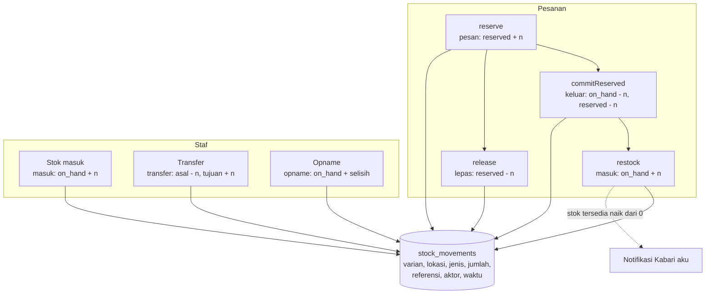

# Arsitektur

Gambaran bagaimana Rona disusun: bagian-bagian sistem, alur pesanan dari keranjang sampai Selesai, alur stok, aturan cache, dan prinsip satu sumber angka. Untuk alasan di balik pilihan-pilihan ini, lihat docs/KEPUTUSAN.md.

## Gambaran sistem

Prinsip penyusunan:

- **Halaman tipis, logika di `src/lib`.** Halaman dan server action hanya memeriksa sesi, izin, dan bentuk masukan, lalu memanggil modul. Modul sebisa mungkin fungsi murni (pricing, shipping, aturan status, laporan), sehingga bisa diuji tanpa database.
- **Server action dan route handler** adalah satu-satunya pintu dari browser. Masing-masing memeriksa sesi dan izin (docs/KEAMANAN.md), lalu memvalidasi masukan dengan skema zod.
- **Database satu**: Postgres di Neon lewat Drizzle. Pencarian memakai full-text Postgres dan `pg_trgm`, tanpa layanan pencarian terpisah.
- **AI lewat satu klien** (`src/lib/ai/client.ts`) ke Cloudflare AI Gateway, dengan batas pemakaian, pencatatan biaya di `ai_logs`, dan mode mock untuk uji.
- **Cron harian** menangani pekerjaan yang tidak bisa menunggu pengunjung: pesanan kedaluwarsa, Selesai otomatis, email, ringkasan ulasan, Kabar Harian, dan reset demo.

### Peta folder

| Folder | Isi |
| --- | --- |
| `src/app` | Halaman toko, panel admin (`admin/(panel)`), route API. |
| `src/components` | Komponen UI, termasuk `ProductArt` (gambar produk ilustrasi). |
| `src/config` | Merek, font, dan sakelar fitur. Satu-satunya tempat nama toko. |
| `src/lib/pricing` | Harga efektif (flash, promo, normal), voucher, poin, ringkasan keranjang. Murni. |
| `src/lib/shipping` | Kurir, tarif per zona, estimasi tiba, pengiriman instan. Murni. |
| `src/lib/inventory` | Kunci baris stok, pesan, lepas, potong, kembalikan, transfer, opname. Selalu menulis `stock_movements`. |
| `src/lib/orders` | Membuat pesanan, transisi status, konfirmasi pembayaran, kedaluwarsa. |
| `src/lib/reports` | Laporan penjualan untuk layar, Excel, dashboard, dan Asisten Admin. |
| `src/lib/ai`, `src/lib/asisten` | Advisor, tafsiran pencarian, foto dan link, Asisten Admin, penulis deskripsi. |
| `src/lib/content` | Teks toko yang dipisah dari komponen. |
| `src/lib/security` | Batas laju dan CSP. |
| `src/db` | Skema, migrasi, seed deterministik, reset. |
| `e2e`, `e2e-produksi` | Uji Playwright lokal dan uji asap produksi. |

## Tanya Rona: satu pintu (Fase 8C)

Otak percakapan (`src/lib/tanya/otak.ts`) dipakai route `/api/ai/advisor` dan evaluasi, jadi perilakunya sama. Setiap kartu dibangun dari fungsi yang juga dipakai halaman biasa: katalog, `susunRutinitas`, `padananShade`, `fitForProfile`, `quoteShippingForZone`, `lacakPesanan`, teks halaman bantuan. Model hanya menerima ringkasan hasil tool tanpa angka; angka tampil di kartu dari data server.

## Alur pesanan: keranjang sampai Selesai

### Status pesanan

Aturan transisi ada di satu tabel (`src/lib/orders/status.ts`) dan dipakai layanan pesanan, tombol admin, dan uji. Setiap transisi menulis riwayat status, log aktivitas, notifikasi, dan baris log terstruktur `pesanan.<status>`.

## Alur stok dan buku besar stok

Stok disimpan per varian per lokasi di tabel `inventory` (`on_hand` fisik dan `reserved` dipesan). Tersedia = `on_hand - reserved`. Setiap perubahan lewat `src/lib/inventory`, di dalam transaksi dengan baris terkunci (`SELECT ... FOR UPDATE`, berurutan menurut id supaya tidak deadlock), dan menulis satu baris `stock_movements`.

| Kejadian | Fungsi | Jenis gerakan | `on_hand` | `reserved` |
| --- | --- | --- | --- | --- |
| Pesanan dibuat | `reserve` | pesan | tetap | + n |
| Batal sebelum bayar, kedaluwarsa | `release` | lepas | tetap | - n |
| Pembayaran dikonfirmasi | `commitReserved` | keluar | - n | - n |
| Batal setelah bayar | `restock` | masuk | + n | tetap |
| Stok masuk dari pemasok | `restock` lewat stok masuk admin | masuk | + n | tetap |
| Transfer antar lokasi | `adjustOnHand` di dua lokasi | transfer | asal - n, tujuan + n | tetap |
| Opname | `adjustOnHand` sebesar selisih | opname | + selisih | tetap |

Retur tidak mengembalikan stok otomatis (hanya menarik poin pesanan itu), karena barang retur perlu dicek dulu. Barang yang layak jual dicatat staf lewat Stok masuk.

Penjaga yang selalu berlaku: `on_hand` dan `reserved` tidak pernah negatif, `reserved` tidak pernah melebihi `on_hand`, opname dan transfer tidak boleh membuat stok fisik di bawah jumlah dipesan. Pelanggaran melempar `StockError` dan seluruh transaksi dibatalkan. Uji `src/lib/inventory/penjaga.integration.test.ts` menjaganya, dan `npm run cek:data` memeriksa bahwa buku stok, stok dipesan, poin, jumlah terjual, kuota flash sale, dan pemakaian voucher cocok dengan saldo.

## Aturan cache

Next.js 16 dengan Cache Components: kerangka halaman diprarender, bagian dinamis mengalir di dalam `Suspense`.

| Data | Cara | Kapan diperbarui |
| --- | --- | --- |
| Nama, deskripsi, merek, kategori, atribut produk, artikel, pengaturan toko | `use cache` + `cacheTag` per produk, kategori, merek | `revalidateTag` saat admin, impor, atau promo mengubahnya |
| Stok, harga efektif, flash sale, kuota | Tanpa cache, di dalam `Suspense` | Dibaca setiap permintaan |
| Keranjang, pesanan, akun, admin | Tanpa cache | Dibaca setiap permintaan |

Semua string tag dibuat lewat helper di `src/lib/cache-tags.ts`, tidak pernah ditulis langsung. Setiap modul yang mengubah data (admin, checkout, inventory, promo, impor) memanggil `revalidateTag` untuk tag yang terdampak lewat helper yang sama.

Build membaca database untuk memprarender katalog, jadi build butuh database yang terjangkau (docs/DEPLOY.md bagian 5).

## Satu sumber angka

Setiap angka yang terlihat di dua tempat dihitung oleh satu fungsi yang sama, bukan dihitung ulang dengan cara berbeda:

- **Harga dan total.** `priceCart` di `src/lib/pricing` dipakai keranjang, ringkasan checkout, pembuatan pesanan, dan total di kartu Advisor. Browser hanya menampilkan. Total yang dikirim browser hanya dipakai untuk mendeteksi harga yang berubah.
- **Ongkir.** `src/lib/shipping` dipakai halaman cek ongkir, checkout, dan pesanan.
- **Laporan.** `src/lib/reports` menghasilkan angka untuk halaman Laporan, ekspor Excel, Dashboard, Kabar Harian, dan jawaban Asisten Admin. Uji memastikan jawaban Asisten Admin tentang omzet sama dengan Laporan untuk periode yang sama.
- **Stok.** Satu modul inventory, satu buku besar `stock_movements`. Saldo bisa direkonstruksi dari buku besar.
- **Poin.** Saldo di `customers.points` selalu sama dengan jumlah `points_ledger`, dicek `npm run cek:data`.
- **AI tidak pernah mengarang angka.** Advisor dan Asisten Admin hanya menampilkan angka dari hasil tool. Penjaga memeriksa setiap rupiah di teks jawaban terhadap harga efektif produk yang direkomendasikan.

## Uji

| Lapisan | Alat | Database |
| --- | --- | --- |
| Logika murni (pricing, shipping, status, laporan, parser impor) | Vitest | Tidak ada |
| Integrasi (pesanan, stok, otorisasi, batas laju, AI mock) | Vitest | `<nama>_uji`, disiapkan ulang setiap kali |
| Alur pengguna, aksesibilitas (axe), perayap tautan, gerak dikurangi, keamanan | Playwright, Chrome dan WebKit | `<nama>_e2e`, disiapkan ulang setiap kali |
| Situs tayang (hanya-baca) | Playwright `npm run uji:produksi` | Produksi, tanpa menulis |
| Konsistensi data | `npm run cek:data` | Database kerja |
| Mutu AI | `npm run eval:ai`, `eval:asisten`, `eval:deskripsi` | Database kerja, Gemini sungguhan |

Catatan untuk menulis uji Playwright:

- Next 16 dengan Cache Components menyimpan halaman sebelumnya di DOM (React Activity, tersembunyi). Pilih elemen yang terlihat dengan `filter({ visible: true })`.
- Uji berjalan di build produksi dengan satu worker, karena uji kedaluwarsa memajukan jam server lewat `/api/demo/jam` (hanya hidup bila `DEMO_MODE=true` dan `ALLOW_CLOCK_OVERRIDE=true`).
